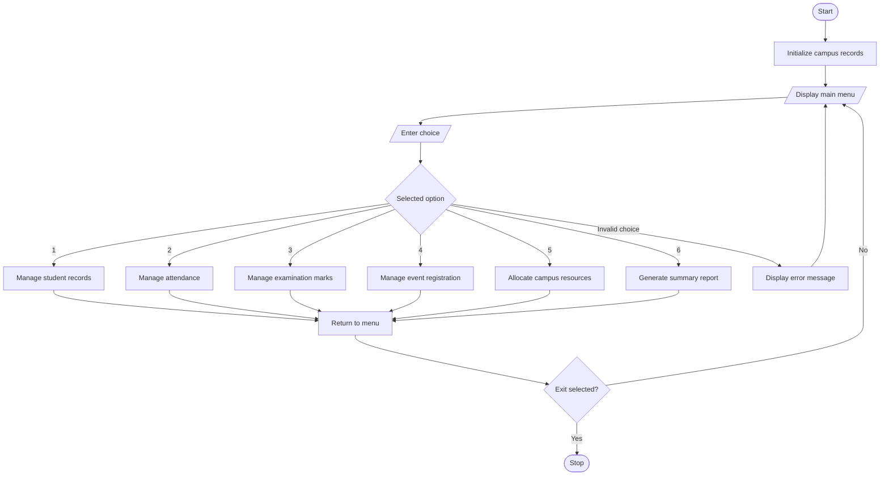

# Problem Statement
The Comprehensive Smart Campus Management Simulation is a menu-driven Python program designed to manage different campus activities in one system. It maintains student records, tracks attendance, records examination marks, manages event registrations, and allocates campus resources. It also generates summary reports for students and campus activities. The program uses conditional statements, loops, strings, lists, nested lists, tuples, and tuple unpacking to organize data, process user choices, and perform campus management operations efficiently.
# Algorithm
1. Start the program.
2. Initialize lists to store student records, attendance, marks, event registrations, and resource allocations.
3. Display a menu with the following options:
   - Student Records
   - Attendance Management
   - Marks Management
   - Event Registration
   - Resource Allocation
   - Summary Report
   - Exit
4. Ask the user to select an option.
5. Use conditional statements to execute the selected operation.
6. For student records, add and display student names, roll numbers, and courses.
7. For attendance, record present or absent status and calculate attendance percentages.
8. For marks, record examination marks and calculate totals and averages.
9. For event registration, register students for campus events.
10. For resource allocation, assign available resources to students or activities.
11. Generate a summary report using loops and stored records.
12. Repeat the menu until the user selects Exit.
13. Stop the program.
# Mermaid Flowchart

# Sample input
Enter your choice: 1
Enter roll number: 101
Enter student name: Ravi
Enter course: CSE

Enter your choice: 2
Enter student roll number: 101
Present or Absent (P/A): P

Enter your choice: 3
Enter student roll number: 101
Enter marks for subject 1 (0-100): 80
Enter marks for subject 2 (0-100): 90
Enter marks for subject 3 (0-100): 85

Enter your choice: 6
