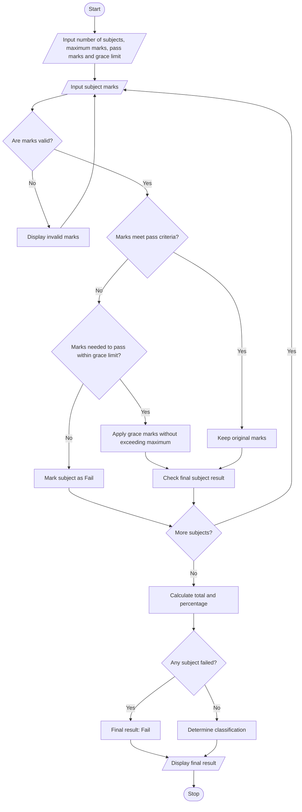

# Problem Statement
The Examination Result and Grace-Mark Validation program is designed to process students' marks across multiple subjects. It checks whether the student has passed or failed each subject based on the minimum pass marks. If a student fails a subject by a small number of marks, the program applies a specified grace-mark policy. It ensures that grace marks do not exceed the maximum marks allowed in any subject and generates the final result classification, such as Pass, Fail, or Distinction.
# Algorithm
1. Start the program.
2. Input the number of subjects.
3. Input the maximum marks, minimum pass marks, and grace-mark limit.
4. For each subject, input the marks obtained.
5. Validate that the marks are between zero and the maximum marks.
6. If the marks meet the pass criteria, mark the subject as Pass.
7. Otherwise, calculate the marks required to pass.
8. If the required marks are within the grace-mark limit, add grace marks without exceeding the maximum marks.
9. Check the subject result again after applying grace marks.
10. Calculate the total marks and percentage using the final marks.
11. If any subject remains failed, declare the result as Fail; otherwise, classify the student based on the percentage.
12. Display subject-wise marks, grace marks applied, total marks, percentage, and final result.
13. Stop the program.
# Mermaid Flowchart

#Sample input
Enter number of subjects: 3
Enter maximum marks per subject: 100
Enter minimum pass marks: 35
Enter grace mark limit per subject: 5
Enter marks for subject 1: 32
Enter marks for subject 2: 80
Enter marks for subject 3: 90
