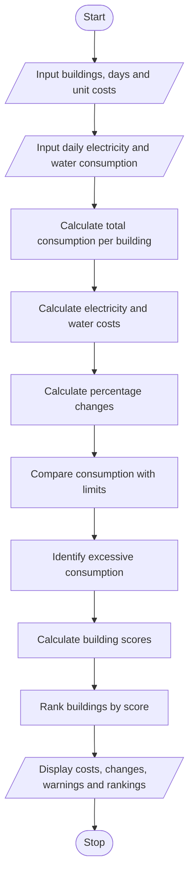

# Problem Statement
The Integrated Campus Energy and Water Audit program is designed to analyze electricity and water consumption across different campus buildings over multiple days. It calculates the total consumption and cost for each building, determines the percentage change in consumption between days, and identifies buildings with excessive energy or water usage. The program also ranks buildings using a specified scoring method to help the college identify high-consumption areas and improve resource management.
# Algorithm
1. Start the program.
2. Input the number of buildings and the number of days.
3. Input the electricity and water consumption for each building on each day.
4. Input the electricity cost per unit and water cost per unit.
5. Calculate the total electricity and water consumption for each building.
6. Calculate the total electricity cost and water cost.
7. Calculate the percentage change in consumption between the first and last day.
8. Compare the average daily consumption with the specified limits to identify excessive consumption.
9. Calculate a score for each building using the specified scoring method.
10. Rank the buildings from highest score to lowest score.
11. Display consumption, costs, percentage changes, excessive-consumption warnings, and building rankings.
12. Stop the program.
# Mermaid Flowchart

#Sample input
Enter number of buildings: 2
Enter number of days: 2
Electricity cost per unit: Rs. 8
Water cost per unit: Rs. 2
Daily electricity limit per building: 100
Daily water limit per building: 500

Enter building 1 name: Library
Day 1 - Library
Electricity units: 100
Water units: 400
Day 2 - Library
Electricity units: 120
Water units: 450

Enter building 2 name: CSE Block
Day 1 - CSE Block
Electricity units: 80
Water units: 300
Day 2 - CSE Block
Electricity units: 90
Water units: 350
