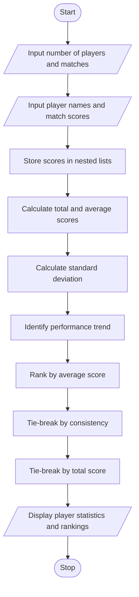

# Problem Statement
The Nested List Sports Performance Analysis program is designed to analyze the performance of multiple players across several matches. It stores player scores using nested lists and calculates each player's total score, average score, and consistency measures. It identifies performance trends by comparing the first and last match scores and ranks players according to their average scores. If two players have the same average, the program applies tie-breaking rules based on consistency and total score.
# Algorithm
1. Start the program.
2. Input the number of players and the number of matches.
3. Enter each player's name and scores for all matches.
4. Store the player names and scores in nested lists.
5. Calculate each player's total score and average score.
6. Calculate the consistency measure using the standard deviation of match scores. A lower standard deviation indicates more consistent performance.
7. Identify the performance trend by comparing the last match score with the first match score.
8. Rank players using the following tie-breaking rules:
   - Higher average score comes first.
   - If averages are equal, lower standard deviation comes first.
   - If both are equal, higher total score comes first.
9. Display each player's total, average, consistency, trend, and rank.
10. Stop the program.
# Mermaid Flowchart

# Sample input
Enter number of players: 3
Enter number of matches: 3

Enter player name: Rahul
Enter score for match 1: 50
Enter score for match 2: 70
Enter score for match 3: 80

Enter player name: Arjun
Enter score for match 1: 60
Enter score for match 2: 60
Enter score for match 3: 60

Enter player name: Kiran
Enter score for match 1: 40
Enter score for match 2: 65
Enter score for match 3: 75
