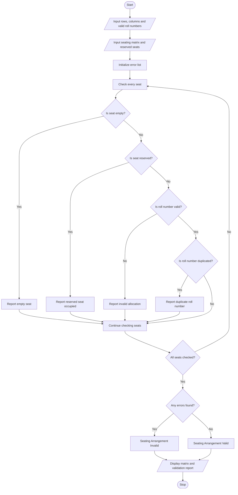

# Problem Statement
The Nested List Examination Seating Validation program is designed to validate the seating arrangement of students in an examination hall. The seating plan is represented using a nested list (matrix), where each cell contains a student roll number or is empty. The program checks for duplicate roll numbers, verifies reserved seats, identifies empty seats, and detects invalid student allocations. Finally, it displays the seating matrix, reports all errors, and determines whether the seating arrangement is valid.
# Algorithm
1. Start the program.
2. Input the number of rows and columns in the seating matrix.
3. Enter the student roll numbers for each seat. Use 0 to represent an empty seat.
4. Input the reserved seat positions.
5. Input the list of valid student roll numbers.
6. Store the seating arrangement as a nested list.
7. Check each seat for empty positions.
8. Check whether any roll number appears more than once.
9. Verify that reserved seats are not occupied.
10. Check whether every allocated roll number belongs to the valid student list.
11. Display the seating matrix and all detected errors.
12. If no errors are found, display “Seating Arrangement Valid”; otherwise, display “Seating Arrangement Invalid.”
13. Stop the program.
# Mermaid Flowchart

# Sample input
Enter number of rows: 2
Enter number of columns: 3
Enter valid roll numbers separated by spaces: 101 102 103 104 105

Enter roll numbers for each seat (0 = empty):
Seat [1,1]: 101
Seat [1,2]: 102
Seat [1,3]: 0
Seat [2,1]: 103
Seat [2,2]: 102
Seat [2,3]: 999

Enter number of reserved seats: 1
Reserved seat row: 1
Reserved seat column: 3

