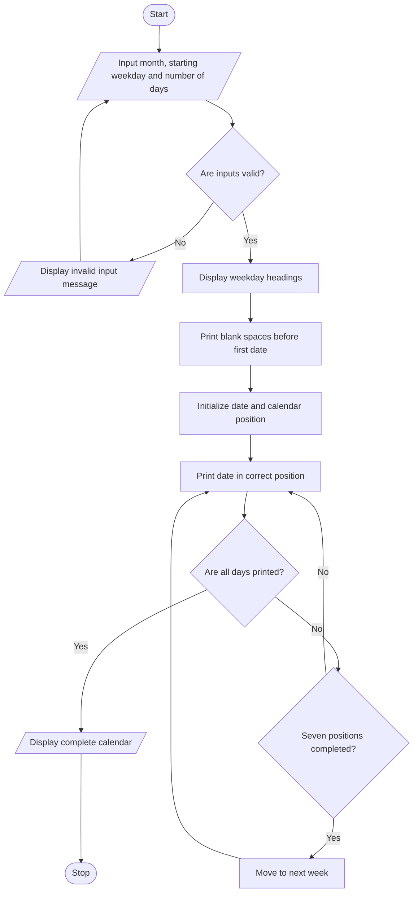

# Problem Statement
The Nested Loop Calendar Generator program generates a monthly calendar using the month name, starting weekday, and number of days in the month. It uses nested loops to arrange dates correctly under the seven weekdays. The program validates the input, handles month lengths of 28, 29, 30, or 31 days, and displays a properly formatted calendar.
# Algorithm
1. Start the program.
2. Input the month name, starting weekday, and number of days.
3. Check whether the starting weekday is valid.
4. Check whether the number of days is 28, 29, 30, or 31.
5. Display the weekday headings from Monday to Sunday.
6. Print blank spaces before the first date according to the starting weekday.
7. Use a loop to print each date in the correct position.
8. Move to the next line after every seven calendar positions.
9. Display the complete monthly calendar.
10. Stop the program.
# Mermaid Flowchart

#Sample input
Enter month name: October
Enter starting weekday: Thursday
Enter number of days in the month: 31

