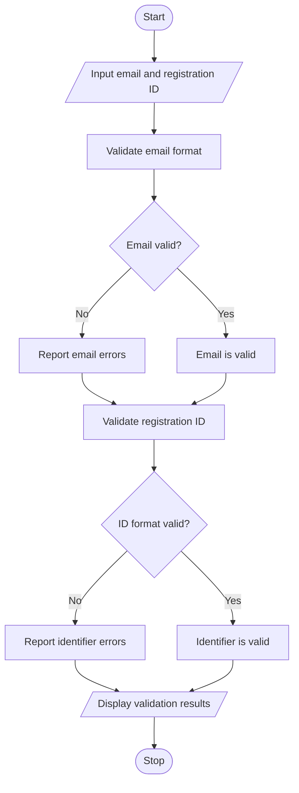

# Problem Statement
The Student Email and Identifier Validation program validates student email addresses and registration identifiers according to specified formatting rules. It checks for missing components, invalid characters, incorrect separators, and improper formatting. The program reports errors and determines whether the email address and registration identifier are valid or invalid.
# Algorithm
1. Start the program.
2. Input the student's email address and registration identifier.
3. Check whether the email contains exactly one @ symbol.
4. Check whether the username and domain are present.
5. Verify that the email does not contain consecutive dots or invalid characters.
6. Check whether the registration identifier follows the required format.
7. Verify the identifier's prefix, length, and character groups.
8. Display any errors found during validation.
9. Display the validity status of the email and identifier.
10. Stop the program.
# Mermaid Flowchart

# Sample input
Enter student email: roopitha123@gmail.com
Enter registration ID: CSE-2026-001
