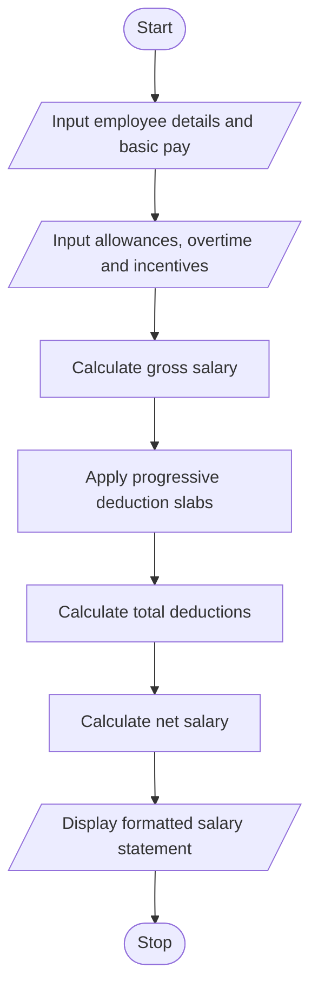

# Problem Statement
The Employee Payroll and Deduction Analysis program calculates an employee's salary based on basic pay, allowances, overtime, and incentives. It calculates the gross salary by adding all earnings and applies progressive deductions according to specified salary ranges. Finally, it calculates the net salary and generates a formatted salary statement showing earnings, deductions, gross salary, and take-home pay.
# Algorithm
1. Start the program.
2. Input the employee's ID, name, and basic salary.
3. Input allowances, overtime pay, and incentives.
4. Calculate total earnings by adding basic salary, allowances, overtime pay, and incentives.
5. Calculate gross salary.
6. Apply progressive deductions according to the specified salary slabs.
7. Calculate total deductions.
8. Calculate net salary by subtracting deductions from gross salary.
9. Display a formatted salary statement containing employee details, earnings, deductions, gross salary, and net salary.
10. Stop the program.
# Mermaid Flowchart

# Sample input
Enter employee ID: E101
Enter employee name: Ravi
Enter basic salary: Rs. 25000
Enter allowances: Rs. 5000
Enter overtime pay: Rs. 2000
Enter incentives: Rs. 3000
