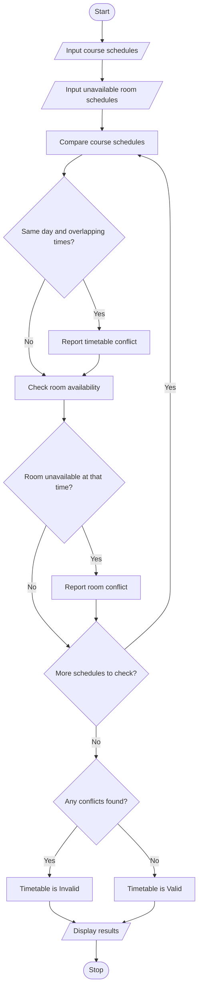

# Problem Statement
The Student Timetable Conflict Detection program is designed to check whether a proposed student timetable is valid. Course schedules are represented using strings and tuples containing the course name, day, start time, end time, and room number. The program detects overlapping class periods, identifies unavailable rooms, and checks whether the proposed timetable contains any scheduling conflicts. Finally, it displays the conflicts and determines whether the timetable is valid.
# Algorithm
1. Start the program.
2. Input the number of courses and their schedule details.
3. Store each course schedule using a tuple containing the course name, day, start time, end time, and room.
4. Use strings to represent course names, days, and room numbers.
5. Compare the schedules of every pair of courses.
6. Check whether two courses occur on the same day and their time periods overlap.
7. If they overlap, report a timetable conflict.
8. Check whether a room is unavailable during the scheduled period.
9. If a room is unavailable, report a room conflict.
10. If no conflicts are found, declare the timetable valid.
11. Otherwise, declare the timetable invalid and display the detected conflicts.
12. Stop the program.
# Mermaid Flowchart

#Sample input
Enter number of courses: 3

Course 1
Enter course name: Python
Enter day: Monday
Enter start hour (0-23): 9
Enter end hour (1-24): 11
Enter room number: R101

Course 2
Enter course name: Mathematics
Enter day: Monday
Enter start hour (0-23): 10
Enter end hour (1-24): 12
Enter room number: R102

Course 3
Enter course name: English
Enter day: Tuesday
Enter start hour (0-23): 9
Enter end hour (1-24): 10
Enter room number: R103

Enter number of unavailable room periods: 1

Unavailable period 1
Enter room number: R103
Enter day: Tuesday
Enter start hour: 9
Enter end hour: 11
